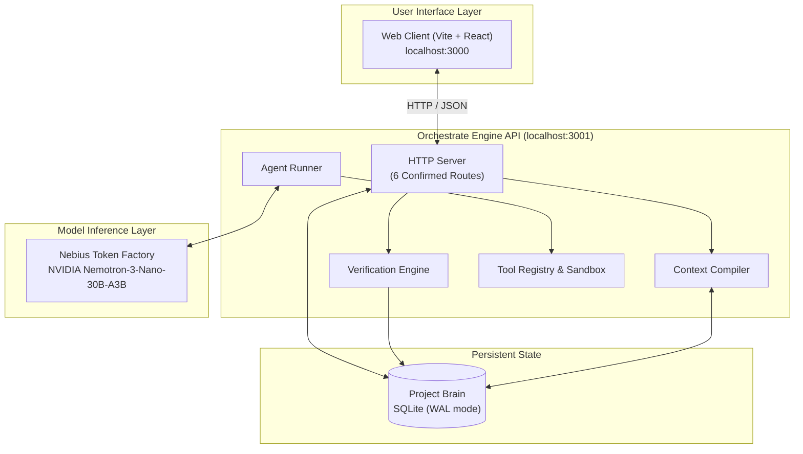

# Orchestrate

> **Evidence-Backed AI Engineering System: Coordinating Multi-Agent Coding Teams with Persistent State, Sandboxed Execution, and Independent Verification.**

[](https://drive.google.com/file/d/1trRBt1jwyZcwi9cSWrrHRki2ZIA__Zi6/view?usp=sharing)
[](https://nebius.com)
[](https://build.nvidia.com)
[](https://www.typescriptlang.org)

📹 **[Watch the 3-Minute Project Demo Video](https://drive.google.com/file/d/1trRBt1jwyZcwi9cSWrrHRki2ZIA__Zi6/view?usp=sharing)**

---

## 🚀 Overview

**Orchestrate** transforms chaotic, stateless AI coding agent chats into a structured, evidence-backed software engineering workflow. Instead of blind trust, Orchestrate introduces:
- **Persistent Project Brain:** Durable SQLite knowledge base tracking architectural decisions, facts, and task handoffs.
- **Independent Verification:** Agent claims are untrusted until independently evaluated by live test and build runners (`VERIFIED` over `CLAIMED`).
- **Container Sandboxing:** Docker/Podman isolation with non-root privileges, drop-ALL capabilities, and zero network leakage for untrusted code execution.
- **Multi-Model Orchestration via Nebius Token Factory:** Role-specific models (Planner, Builder, Reviewer, Repairer) powered by high-performance NVIDIA models.
- **Tenant Isolation & Security:** Cryptographic HMAC-SHA256 JWT auth, opaque IDOR defense, and strict workspace path containment.

---

## 1. Source-of-Truth Hierarchy

Orchestrate enforces a strict epistemic hierarchy when determining how much to trust state:

```
    CODE
      ↓
VERIFICATION EVIDENCE
      ↓
 PROJECT BRAIN
      ↓
  AGENT CLAIMS
```

An agent's statement that work is complete is an **untrusted claim**, not verification. Orchestrate requires independent verification checks before promoting claims into durable project state.

---

## 2. System Architecture



### Core Architecture Components

- **`ModelClient`** — Communicates with AI model providers. In the hackathon MVP, **Nebius Token Factory** is the sole implemented inference provider.
- **`AgentRunner`** — Owns the agent execution loop and coordinates model/tool interaction.
- **`ToolRegistry`** — Exposes controlled filesystem, terminal, and version control capabilities to agents.
- **`Workspace`** — Provides an isolated, tamper-evident execution environment with strict path containment.
- **`Verification`** — Independently executes configured test, lint, and build checks against live workspaces.
- **`Telemetry`** — Captures chronological execution traces, token usage, and timing data without persisting secrets.
- **`Project Brain`** — Stores structured project state, task handoffs, and evidence-backed knowledge in SQLite.
- **`Context Compiler`** — Selects and compacts relevant project state into deterministic context envelopes for downstream tasks.

For a detailed walkthrough of the complete lifecycle and Task A → Task B handoff, see [`docs/END_TO_END_ENGINEERING_FLOW.md`](./docs/END_TO_END_ENGINEERING_FLOW.md).

---

## Model Selection & Control Architecture

Orchestrate enforces a foundational architectural principle:

> **"Users choose models in normal project execution. Experiments choose and lock models."**

For complete details, see [`docs/NEBIUS_MODEL_SELECTION_AND_CONTROL.md`](./docs/NEBIUS_MODEL_SELECTION_AND_CONTROL.md).

### 1. Normal Project Execution

In normal engineering workflows:
- **Provider:** All inference is executed through **Nebius Token Factory**.
- **Model Selection:** Users may select and configure any model supported by their Nebius Token Factory deployment (with **NVIDIA Nemotron** demonstrated as the primary NVIDIA open-source model family).
- **Role-Based Configuration:** Tasks can configure role-specific models:
  - `planner` — high-level decomposition and architecture planning.
  - `builder` — code modification and implementation.
  - `reviewer` — independent code review and diff auditing.
  - `repairer` — targeted remediation after verification failure.
  - `summarizer` — state extraction and task handoff compilation.
- **Default Fallback:** All roles fall back to the project default Nebius model unless explicitly overridden.
- **Discovery:** Model IDs can be queried via the official Nebius `GET /v1/models` catalog endpoint.
- **Provenance:** Every completion event records the provider (`nebius`), model identifier, inference parameters, and token usage into immutable evidence. API keys and secrets are strictly redacted.

```
┌─────────────────────────────────────────────────────────┐
│                      Orchestrator                       │
│  (Coordinates Brain, Compiler, Runner, Verification)    │
└───────────────────────────┬─────────────────────────────┘
                            │
                            ▼
┌─────────────────────────────────────────────────────────┐
│                       ModelClient                       │
│          (Resolves role config & default model)         │
└───────────────────────────┬─────────────────────────────┘
                            │
                            ▼
┌─────────────────────────────────────────────────────────┐
│                  NebiusModelClient                      │
│            (Token Factory API / v1 / HTTPS)             │
└───────────────────────────┬─────────────────────────────┘
                            │
                            ▼
┌─────────────────────────────────────────────────────────┐
│                  Selected Nebius Model                  │
│   e.g. nvidia/nemotron-4-340b-instruct                  │
│   or meta-llama/Llama-3.3-70B-Instruct                  │
└─────────────────────────────────────────────────────────┘
```

### 2. Benchmark Execution

In scientific benchmark evaluation:
- **Locked Experimental Control:** Model identity and inference configuration are **controlled experimental variables**.
- **Cross-Arm Equality:** All three experimental arms (`ARM_A_BASELINE`, `ARM_B_UNVERIFIED_HANDOFF`, and `ARM_C_ORCHESTRATE`) must use the **exact same model identity** and **exact same inference configuration**:
  ```
  ControlFingerprint(ARM_A) == ControlFingerprint(ARM_B) == ControlFingerprint(ARM_C)
  ```
- **Treatment Isolation:** Model identity is strictly excluded from `TreatmentFingerprint`. Only the context representation supplied to Agent B differs.
- **Invalidation:** Any model or inference configuration divergence between arms violates experimental control and immediately marks the trial as `INVALID`. The benchmark never attributes model-quality divergence to the Orchestrate treatment.

```
┌─────────────────────────────────────────────────────────┐
│                   Experiment Config                     │
│  Selected Model: nebius/<model-id>                      │
│  Inference Config: { temperature, topP, maxTokens, seed }│
└───────────────────────────┬─────────────────────────────┘
                            │
                            ▼ (LOCKED)
┌─────────────────────────────────────────────────────────┐
│                  Control Fingerprint                    │
│  modelIdentity + inferenceConfigHash                    │
└───────────────────────────┬─────────────────────────────┘
                            │
         ┌──────────────────┼──────────────────┐
         │                  │                  │
         ▼                  ▼                  ▼
┌─────────────────┐┌─────────────────┐┌─────────────────┐
│     ARM A       ││     ARM B       ││     ARM C       │
│  (Baseline)     ││  (Unverified)   ││  (Orchestrate)  │
│                 ││                 ││                 │
│  Locked Model   ││  Locked Model   ││  Locked Model   │
│  Locked Config  ││  Locked Config  ││  Locked Config  │
│  NO CONTEXT     ││  RAW HANDOFF    ││  COMPILED CTX   │
└─────────────────┘└─────────────────┘└─────────────────┘
         ▲                  ▲                  ▲
         └──────────────────┴──────────────────┘
            ONLY THE CONTEXT TREATMENT DIFFERS
```

### 3. Future Provider Extensibility

The `ModelClient` interface provides a clean, decoupled boundary:

```
                     ┌──────────────────┐
                     │   ModelClient    │ (Interface seam)
                     └────────┬─────────┘
                              │
     ┌────────────────────────┼────────────────────────┐
     │ (CURRENT HACKATHON)    │ (FUTURE)               │ (FUTURE)
     ▼                        ▼                        ▼
┌───────────────┐      ┌───────────────┐        ┌───────────────┐
│ Nebius Client │      │ OpenAI Adapter│        │Anthropic Adapt│
└───────┬───────┘      └───────────────┘        └───────────────┘
        │
        ▼
Selected Nebius Model
```

---

## Project Scope

### Current Hackathon Implementation (In Scope)
- **Nebius Token Factory** inference client.
- **NVIDIA open-source model / Nemotron** demonstrated on Nebius Token Factory.
- Selectable Nebius model configuration per project and task.
- Role-based model configuration (`planner`, `builder`, `reviewer`, `repairer`, `summarizer`).
- Execution provenance and token usage tracking.
- Model-locked benchmark experiments with cryptographic control fingerprints.
- Strict secret redaction across all logs, telemetry, and error messages.

### Out of Scope for Hackathon (Future Work)
- OpenAI API adapter.
- Anthropic/Claude adapter.
- OpenCode integration.
- Ollama or local model runners.
- Multi-provider dynamic routing or cross-provider failover.
- Provider marketplace UI.

---

## Monorepo Packages

| Package | Description |
|---|---|
| [`packages/model`](./packages/model) | Low-level model abstractions, `NebiusModelClient`, model config types, and discovery |
| [`packages/core`](./packages/core) | Minimal orchestrator, `AgentRunner`, and tool registry |
| [`packages/brain`](./packages/brain) | Append-only SQLite Project Brain storing verified records, handoffs, and tenant ownership |
| [`packages/compiler`](./packages/compiler) | Context compiler selecting and formatting evidence into task context |
| [`packages/verification`](./packages/verification) | Independent verification engine evaluating tests, lints, and builds |
| [`packages/workspace`](./packages/workspace) | Command execution isolation with `DockerSandboxCommandExecutor` and `LocalCommandExecutor` |
| [`packages/benchmark`](./packages/benchmark) | Controlled A/B/C benchmark harness, trial runner, and metric evaluators |
| [`packages/telemetry`](./packages/telemetry) | Secret-redacted execution logging and observability |

---

## Security Architecture & Hardening

Orchestrate has undergone foundational security hardening for agent execution and API control:

### 1. Sandboxed Agent Execution (P0)
- **Container Isolation:** In production (`NODE_ENV=production`), untrusted agent commands execute within ephemeral Docker containers via `DockerSandboxCommandExecutor`.
- **Restricted Privileges:** Hardened with `--network none`, `--cap-drop ALL`, read-only root filesystems, resource limits (2 CPUs, 2GB memory, 64 PIDs), non-root user execution (`1000:1000`), and strict execution timeouts (default 30 seconds).
- **Fail-Closed Policy:** In production, if Docker or the sandbox container is unavailable, execution fails closed with `SandboxUnavailableError`. It never silently falls back to host execution.
- **Environment Scrubbing:** Subprocesses receive a strict, minimal environment allowlist (`PATH`, `LANG`, `LC_ALL`, `NODE_ENV`, `HOME`, `TERM`). Server secrets, API keys, and database credentials are never exposed to agent containers.
- See [`docs/secure-agent-execution.md`](./docs/secure-agent-execution.md) for full architecture details.

### 2. Authentication, Authorization & Tenant Isolation (P0.2)
- **Cryptographic JWT Authentication:** All non-public endpoints require `Authorization: Bearer <token>` signed via HMAC-SHA256 (`alg: HS256`). Public endpoints are strictly limited to `GET /health` and CORS preflight (`OPTIONS`).
- **Secret Enforcement:** In production, `ORCHESTRATE_JWT_SECRET` must be configured with a minimum of 32 characters. Default development keys cause an immediate startup failure.
- **Tenant Data Isolation:** Projects and associated entities (tasks, handoffs, verifications, facts) are bound to `ownerId`. Cross-tenant queries return uniform `404 Not Found` (IDOR defense) without disclosing resource existence.
- **In-Memory State Scoping:** Diffs, task events, timeline streams, and cancellation controllers are keyed by `${userId}:${projectId}:${taskId}`, preventing cross-user eavesdropping or disruption.
- **Per-User Provider Credentials:** Nebius model configurations and API keys are stored per user context. One user's settings never overwrite global environment variables or affect other tenants.
- **Filesystem Protections:** `POST /projects/open-folder` and local filesystem repository imports are blocked with `403 Forbidden` in production mode.

---

## Environment Variables

| Variable | Required In | Description |
|---|---|---|
| `NODE_ENV` | All | Runtime environment (`development`, `test`, `production`). Enforces strict security invariants in `production`. |
| `ORCHESTRATE_JWT_SECRET` | Production | High-entropy signing secret ($\ge 32$ characters) for authenticating API requests. |
| `ORCHESTRATE_HOST` | Development | Bind address for Engine API (default: `127.0.0.1`). |
| `ORCHESTRATE_PORT` | Development | Port for Engine API (default: `3001`). |
| `ORCHESTRATE_DB_PATH` | Development | Path to SQLite Project Brain database file (default: `./orchestrate.sqlite`). |
| `ORCHESTRATE_CORS_ORIGIN` | Optional | Allowed CORS origin (default: `http://localhost:3000`). |
| `NEBIUS_API_KEY` | Execution | Default Nebius Token Factory API key for live AI model inference. Can also be supplied per-user via API. |
| `NEBIUS_DEFAULT_MODEL` | Optional | Default model identifier (default: `nvidia/NVIDIA-Nemotron-3-Nano-30B-A3B`). |
| `VITE_ENGINE_URL` | Web Frontend | Base URL of Engine API (default: `http://127.0.0.1:3001`). |

---

## Documentation

### Core Specifications & Deployment
- [`docs/api-contract.md`](./docs/api-contract.md) — **Frozen Engine API Contract**: Strict specifications for confirmed routes and error formats.
- [`docs/secure-agent-execution.md`](./docs/secure-agent-execution.md) — **Sandboxed Agent Execution**: Architecture, container restrictions, and operational runbook.
- [`docs/evaluation-final.md`](./docs/evaluation-final.md) — **Final Benchmark Evaluation Report & Closure**: Frozen results across Runs 1–4, Arm C `VERIFIED` outcome, and mandatory methodological disclosures.
- [`docs/deployment.md`](./docs/deployment.md) — **Manual Deployment & Operations Guide**: Step-by-step setup, process management, database maintenance, and security hardening.
- [`docs/demo-script.md`](./docs/demo-script.md) — **3-Minute Video Demo Script**: Technical pitch and step-by-step live product demonstration.
- [`docs/devpost-draft.md`](./docs/devpost-draft.md) — **Devpost Submission Draft**: Complete hackathon submission narrative and technical overview.

### Architecture & Experiment Protocols
- [`docs/END_TO_END_ENGINEERING_FLOW.md`](./docs/END_TO_END_ENGINEERING_FLOW.md) — Comprehensive guide to the end-to-end engineering flow (Task → Agent Execution → Code Change → Handoff → Independent Verification → Project Brain → Context Compiler → Dependent Agent)
- [`docs/NEBIUS_MODEL_SELECTION_AND_CONTROL.md`](./docs/NEBIUS_MODEL_SELECTION_AND_CONTROL.md) — Architecture decision on Nebius model selection & benchmark control
- [`docs/EXPERIMENT_PROTOCOL.md`](./docs/EXPERIMENT_PROTOCOL.md) — Benchmark experiment methodology and evaluation protocols
- [`docs/TRIAL_RUN_CONTRACT.md`](./docs/TRIAL_RUN_CONTRACT.md) — Benchmark trial lifecycle, failure taxonomy, and contracts
- [`docs/HARNESS_EXECUTION_CONTRACT.md`](./docs/HARNESS_EXECUTION_CONTRACT.md) — Execution harness invariants and fingerprinting rules
- [`docs/DISCOVERY_MEASUREMENT.md`](./docs/DISCOVERY_MEASUREMENT.md) — Discovery action taxonomy and scoring rules
- [`docs/ARTIFACT_MANIFEST.md`](./docs/ARTIFACT_MANIFEST.md) — Task-A artifact manifest specification
- [`docs/TASK_A_SNAPSHOT_CONTRACT.md`](./docs/TASK_A_SNAPSHOT_CONTRACT.md) — Canonical snapshot commit requirements
- [`docs/EXPERIMENTAL_ARM_ISOLATION.md`](./docs/EXPERIMENTAL_ARM_ISOLATION.md) — Arm workspace isolation rules

---

## Getting Started

### Prerequisites
- Node.js 22.8.0+ (tested on Node 22 & 24)
- npm 10+
- Git

### Quickstart Setup

1. **Install Dependencies:**
   ```bash
   npm install
   ```

2. **Configure Environment:**
   ```bash
   cp .env.example .env
   ```

3. **Build Packages & Web Client:**
   ```bash
   npm run build
   npm run web:build
   ```

4. **Seed Project Brain with Historical Run 4 Data:**
   ```bash
   npm run seed
   ```

5. **Run Preflight Smoke Test:**
   ```bash
   npm run smoke:test
   ```

### Running Locally

- **Start Engine API** (`http://127.0.0.1:3001`):
  ```bash
  npm run engine:dev
  ```

- **Start Web Dashboard** (`http://localhost:3000`):
  ```bash
  npm run web:dev
  ```

### Running the Test Suite

```bash
npm test
```

---

## Current Status & Deployment Prerequisites

Orchestrate has verified core security foundations (isolated container execution, JWT authentication, tenant scoping, and fail-closed invariants). Before deploying as an open multi-user cloud service on the public internet, the following operational requirements remain:

1. **Rate Limiting & Abuse Prevention:** The API currently executes without token or task invocation rate limits. Cloud deployments require an ingress rate limiter (e.g. Cloudflare / Envoy / Redis token bucket) to protect against resource exhaustion.
2. **Git Egress Whitelisting:** Remote Git cloning accepts public Git URLs. An egress proxy or network firewall rule must restrict outbound Git cloning traffic to trusted platforms (`github.com`, `gitlab.com`) and block loopback/RFC-1918 internal metadata IP addresses.
3. **Database Topology:** SQLite in WAL mode safely handles concurrent requests on a single host. Horizontal container autoscaling across multiple nodes requires a shared PostgreSQL database adapter.
4. **Sandbox Daemon Prerequisite:** In production mode, the host must have Docker/containerd running with the `orchestrate-sandbox:latest` image pre-built (`docker build -t orchestrate-sandbox:latest -f deploy/sandbox/Dockerfile .`).
