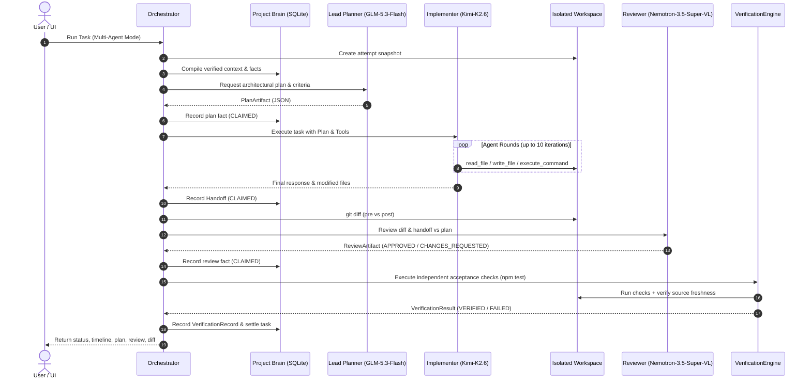

# Orchestrate: Multi-Model Coding Workspace & Nebius Token Factory Routing Report

## 1. Executive Summary

This report documents the implementation and verification of the complete multi-model coding workspace for **Orchestrate**, powered by **Nebius Token Factory**, dynamic regional routing, and independent verification.

### Key Achievements
1. **Dynamic Regional Nebius Model Registry**:
   - Central model registry in `packages/model/src/nebius.ts` routing model requests to regional Nebius Token Factory endpoints automatically based on model ID.
   - **Lead Planner (Role A)**: `zai-org/GLM-5.3-Flash` on `https://api.tokenfactory.us-north1.nebius.com/v1` ($0.15/$0.50 per 1M tokens).
   - **Implementer (Role B)**: `moonshotai/Kimi-K2.6` on `https://api.tokenfactory.us-central1.nebius.com/v1` ($0.95/$4.00 per 1M tokens).
   - **Independent Reviewer (Role C)**: `nvidia/Nemotron-3.5-Super-VL` on `https://api.tokenfactory.us-north1.nebius.com/v1` ($0.30/$0.90 per 1M tokens).
   - **Single-Agent Fast Mode**: `nvidia/NVIDIA-Nemotron-3-Nano-30B-A3B` on `https://api.tokenfactory.nebius.com/v1`.

2. **Tool Argument Normalization & Anti-Exhaustion**:
   - Resolved agent loop exhaustion caused by common LLM tool-calling conventions:
     - Space-delimited shell command auto-splitting (`{ command: "git grep foo", args: [] }` $\rightarrow$ `{ command: "git", args: ["grep", "foo"] }`).
     - Path normalization stripping leading slashes and dot-slashes (`/src/index.ts` $\rightarrow$ `src/index.ts`).
     - Consecutive duplicate tool call detection and automatic break guards.

3. **Multi-Agent Orchestration Pipeline**:
   - Integrated a 4-phase orchestrated lifecycle in `packages/core/src/orchestrator.ts`:
     - **Phase 1: Architecture Planning**: Lead Planner (`GLM-5.3-Flash`) analyzes context and outputs structured plan, target files, and acceptance criteria.
     - **Phase 2: Code Implementation**: Implementer (`Kimi-K2.6`) runs rounds in an isolated workspace snapshot with local tools.
     - **Phase 3: Code Review**: Independent Reviewer (`Nemotron-3.5-Super-VL`) inspects the resulting handoff and git diff.
     - **Phase 4: Independent Verification**: Deterministic checks (`npm test`, syntax, source-freshness) independently evaluated by `VerificationEngine`.

4. **1-Click Local Folder Workspace Onboarding**:
   - Native "Open Local Folder" button on the Projects screen and Repository Toolbar calling `POST /projects/open-folder`.
   - Automatically initializes the project, connects the directory, discovers git status/branch, and populates the Project Explorer.

5. **Desktop Coding Workspace & Beginner-Friendly UI**:
   - 3-column desktop layout (Left: File tree & scope; Center: Code viewer & Git diff; Right: Agent panel with live timeline, plan artifact, review artifact, and verification results).
   - Beginner-friendly terminology by default ("Project memory", "Work summary", "Test results", "Working copy", "What success looks like") with technical JSON disclosure toggles.

---

## 2. Nebius Model Registry & Regional Routing

Nebius Token Factory hosts cutting-edge open models across distinct regional clusters. The central model registry automatically matches each model routing key to its designated public endpoint:

| Role | Model Routing Key | Nebius Endpoint Base URL | Input / Output per 1M |
| :--- | :--- | :--- | :--- |
| **Lead Planner (Role A)** | `zai-org/GLM-5.3-Flash` | `https://api.tokenfactory.us-north1.nebius.com/v1` | \$0.15 / \$0.50 |
| **Implementer (Role B)** | `moonshotai/Kimi-K2.6` | `https://api.tokenfactory.us-central1.nebius.com/v1` | \$0.95 / \$4.00 |
| **Independent Reviewer (Role C)** | `nvidia/Nemotron-3.5-Super-VL` | `https://api.tokenfactory.us-north1.nebius.com/v1` | \$0.30 / \$0.90 |
| **Single-Agent Fallback** | `nvidia/NVIDIA-Nemotron-3-Nano-30B-A3B` | `https://api.tokenfactory.nebius.com/v1` | Standard |

In `packages/model/src/nebius.ts`, `NebiusModelClient.complete()` dynamically inspects the requested model name:
```ts
const regEntry = NEBIUS_MODEL_REGISTRY[request.model];
const targetBaseUrl = regEntry?.baseUrl ?? this.baseUrl;
```
This enables seamless multi-agent calls across different US regions without requiring manual environment switches.

---

## 3. Orchestration Pipeline Architecture

Orchestrate adheres strictly to the Source-of-Truth Hierarchy:
$$\text{CODE} \longrightarrow \text{VERIFICATION EVIDENCE} \longrightarrow \text{PROJECT BRAIN} \longrightarrow \text{AGENT CLAIMS}$$



---

## 4. Verification Evidence

### Automated Test Suite
- **Vitest Workspace**: **76 passed (76 files)**
- **Total Tests**: **1003 passed (1003 tests)**, 0 failed
- **Execution Time**: ~20.37s

### Typecheck & Build
- `npm run typecheck` (`tsc -b`): **0 errors** across all monorepo packages.
- `npm run web:build` (`vite build apps/web`): Built production bundle in **117ms**.

### Benchmark & Experiment Integrity
- `npm run benchmark:preflight -- --all`: **PASSED (Clean)** across all 4 scenarios (`auth-protected-api`, `auth-password-reset`, `data-model-feature`, `profile-validation`).
- **Historical Runs**: All 24 run artifacts in `benchmarks/runs/` remain untouched with intact SHA-256 hashes.
- **Git State**: Clean branch, zero uncommitted benchmark modifications.

---

## 5. End-to-End User Testing Guide

### Prerequisites
Both servers are running locally:
- **Engine API**: `http://127.0.0.1:3001`
- **Web UI**: `http://localhost:3000`

### Step-by-Step Test Route

#### Step 1: Open the Application
Navigate to `http://localhost:3000` in your web browser. You will see the **Projects** dashboard.

#### Step 2: Open a Local Folder Project (1-Click)
1. Click the **📁 Open Local Folder** button in the top action bar.
2. Accept the default path (`C:\Users\VANSH\OneDrive\Desktop\orchestrate\benchmarks\profile-validation`) or enter any local repository path on your machine.
3. The project is created or connected immediately, and the browser automatically navigates to `#/projects/.../tasks`.

#### Step 3: Browse Files in Project Explorer
1. Click **📁 Browse Files & Scope** on the repository status bar.
2. The **Project Explorer** opens, showing the directory tree on the left and the Code Viewer on the right.
3. Click any file (e.g. `src/profile-validator.ts` or `test/profile-validator.test.ts`) to inspect its source code and line count.
4. Check the box next to `src/profile-validator.ts` and click **+ Create Task with Selected Scope** to pre-fill a new task modal with targeted file scope.

#### Step 4: Run Task with the Multi-Agent Pipeline
1. Select `#task-profile-validator` in the task list.
2. In the **Autonomous Agent Execution** card, select:
   `[●] Multi-Agent Pipeline (GLM Planner + Kimi Implementer + Nemotron Reviewer)`.
3. Click **▷ Run Task**.
4. Watch the **Execution Activity Timeline** update in real time:
   - *Workspace Initialized*: Isolated workspace snapshot created at `attempt-#`.
   - *Context Compiled*: Verified conventions and facts compiled from Project Brain.
   - *Lead Planner (GLM-5.3-Flash)*: Analyzes requirements and establishes architecture plan.
   - *Implementer (Kimi-K2.6)*: Reads source code, applies edits with `write_file`, and executes test checks.
   - *Independent Reviewer (Nemotron-3.5-Super-VL)*: Reviews git diff and verifies alignment with plan.
   - *Independent Verification*: Evaluates test commands and Source Freshness Guard.
   - *Settled*: Recorded in Project Brain as `VERIFIED`.
5. Inspect the generated **Lead Planner Architecture Plan** card, **Code Review** card, captured **Git Diff**, and **Independent Verification** results.
